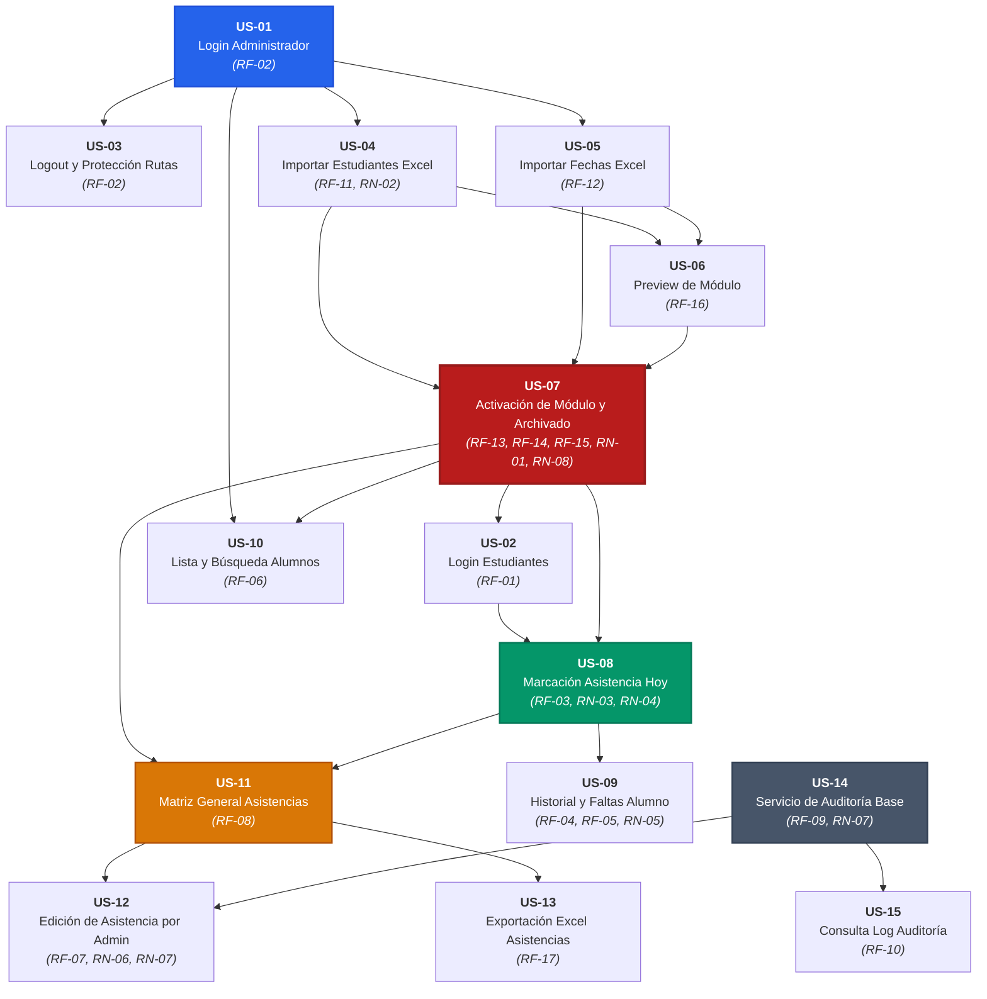
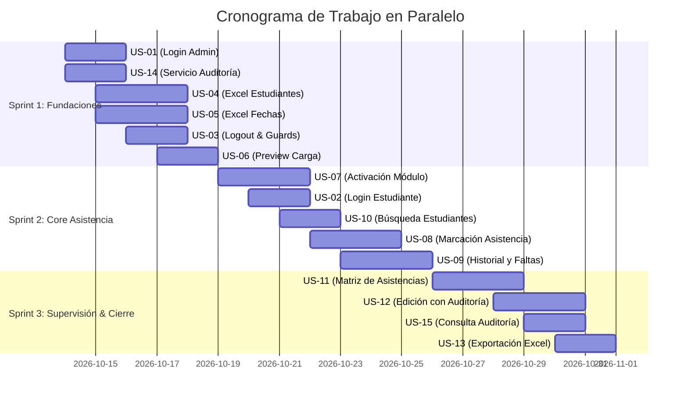

# Mapa de Dependencias y Estrategia de Trabajo en Paralelo

Este documento describe la red de dependencias entre las Historias de Usuario (**US-01 a US-15**), identifica el camino crítico del proyecto y define una estrategia de paralelización para que un equipo multidisciplinario pueda avanzar de forma simultánea sin cuellos de botella ni bloqueos.

---

## 1. Matriz de Dependencias entre Historias de Usuario

| ID | Historia de Usuario | Dependencias Directas (Bloqueado por) | Historias que Desbloquea | Nivel de Precedencia |
| :--- | :--- | :--- | :--- | :--- |
| **US-01** | Acceso de Administrador con Credenciales | *Ninguna* (Fundacional) | US-03, US-04, US-05, US-10, US-14 | **Nivel 0** (Semilla) |
| **US-14** | Registro Centralizado de Auditoría | *Ninguna* (Arquitectura base) | US-12, US-15 | **Nivel 0** (Semilla) |
| **US-04** | Importación Excel de Estudiantes | US-01 | US-06, US-07 | **Nivel 1** |
| **US-05** | Importación Excel de Fechas y Horarios | US-01 | US-06, US-07 | **Nivel 1** |
| **US-03** | Cierre de Sesión y Control de Roles | US-01 | *Mejora de seguridad transversal* | **Nivel 1** |
| **US-06** | Vista Previa de Datos antes de Activar | US-04, US-05 | US-07 | **Nivel 1.5** |
| **US-07** | Activación de Nuevo Módulo y Archivado | US-04, US-05 (o US-06) | US-02, US-08, US-10, US-11 | **Nivel 2** (Hito Clave) |
| **US-02** | Acceso de Estudiantes al Módulo Activo | US-07 | US-08, US-09 | **Nivel 2.5** |
| **US-10** | Consulta y Búsqueda de Estudiantes | US-01, US-07 | US-11 | **Nivel 2.5** |
| **US-08** | Marcación de Asistencia en Día de Clase | US-02, US-07 | US-09, US-11, US-12 | **Nivel 3** |
| **US-09** | Historial Personal y Resumen de Faltas | US-02, US-08 | *Consumo final de alumno* | **Nivel 3.5** |
| **US-11** | Vista General y Matriz de Asistencias | US-07, US-08 (o datos) | US-12, US-13 | **Nivel 3.5** |
| **US-12** | Modificación de Asistencia por Admin | US-11, US-14 | *Operación administrativa avanzada* | **Nivel 4** |
| **US-15** | Consulta y Filtrado de Auditoría | US-14 | *Panel de auditoría administrativo* | **Nivel 4** |
| **US-13** | Exportación de Asistencias a Excel | US-11 | *Funcionalidad opcional final* | **Nivel 4** |

---

## 2. Grafo Visual de Dependencias (Mermaid)

El siguiente diagrama de flujo ilustra la secuencia de dependencias, desde la arquitectura fundacional hasta las funcionalidades de reporte y auditoría:



---

## 3. Análisis del Camino Crítico (Critical Path)

El camino crítico representa la secuencia de historias que determina la duración mínima para tener el producto mínimo viable (MVP) completamente operativo:

$$\text{US-01} \xrightarrow{} \text{US-04 \& US-05} \xrightarrow{} \text{US-07} \xrightarrow{} \text{US-02} \xrightarrow{} \text{US-08} \xrightarrow{} \text{US-11} \xrightarrow{} \text{US-12}$$

* **Cualquier retraso en este camino retrasa la entrega completa del sistema.**
* **Cuello de botella principal:** `US-07 (Activación del Módulo)`. Sin un módulo activo en la base de datos, los estudiantes no pueden autenticarse ni marcar asistencia.

---

## 4. Estrategia de Trabajo en Paralelo para el Equipo

Para aprovechar la capacidad del equipo de desarrollo y evitar que los desarrolladores se bloqueen esperando a otros, dividimos el trabajo en **4 Tracks (Líneas de Trabajo) Autónomas**:

```
[Track A: Auth & Módulos]       ─► US-01, US-03, US-07
[Track B: Excel & Estudiantes]   ─► US-04, US-05, US-06, US-10
[Track C: Flujo Estudiante]     ─► US-02, US-08, US-09
[Track D: Matriz & Auditoría]   ─► US-14, US-11, US-12, US-13, US-15
```

### 4.1 Definición de los 4 Tracks de Trabajo

#### Track 1: Identidad, Seguridad y Ciclo de Vida del Módulo (Core Admin)
* **Responsable sugerido:** Desarrollador Backend Principal / Lead
* **Historias:** `US-01` (Login Admin), `US-03` (Guards & Logout), `US-07` (Activación transaccional de módulo).
* **Entregable clave:** Infraestructura JWT, migración de `academic_modules`, lógica de estado único activo (**RN-01** y **RN-08**).

#### Track 2: Procesamiento Excel y Nómina de Alumnos
* **Responsable sugerido:** Desarrollador 2 (Especialista en Integraciones / Datos)
* **Historias:** `US-04` (Importador Excel Alumnos), `US-05` (Importador Excel Fechas), `US-06` (Preview UI), `US-10` (Búsqueda de alumnos).
* **Entregable clave:** Servicios de parseo Excel con `xlsx`/`exceljs`, validaciones de formato, detección de duplicados (**RN-02**) y endpoints de preview.

#### Track 3: Experiencia del Estudiante y Marcación de Asistencias
* **Responsable sugerido:** Desarrollador 3 (Fullstack / Frontend enfocado en Estudiante)
* **Historias:** `US-02` (Login Estudiante), `US-08` (Botón de marcación con control de fecha), `US-09` (Historial y Faltas).
* **Entregable clave:** Pantallas móviles/responsive para estudiantes, validación de horario de servidor vs cliente, cálculo automático de `FALTA` en fechas pasadas (**RN-04**, **RN-05**).

#### Track 4: Supervisión Administrativa, Auditoría y Reportes
* **Responsable sugerido:** Desarrollador 4 (Fullstack / Backend enfocado en Administración)
* **Historias:** `US-14` (Entidad e interceptores de `ActivityLog`), `US-11` (Matriz y filtros de asistencias), `US-12` (Edición manual con auditoría), `US-15` (Log viewer), `US-13` (Exportación Excel).
* **Entregable clave:** Matriz cruzada de asistencias en frontend, auditoría inmutable en backend (**RN-06**, **RN-07**).

---

## 5. Estrategia de Desacoplamiento (Frontend y Backend en Paralelo)

Para que el equipo de **Frontend** no espere a que el equipo de **Backend** termine las APIs:

### 5.1 Enfoque API-First con Contratos Simulados (Mocking)
1. **Día 1:** Todo el equipo aprueba las interfaces TypeScript de petición y respuesta (ya documentadas en `docs/historias-de-usuario.md`).
2. **Frontend Mock Handler:** Frontend utiliza un adaptador simulado en memoria o Next.js Route Handlers locales (`src/app/api/mock/*`) para renderizar componentes inmediatamente.
3. **Validación con DTOs compartidos:** Los tipos de datos definidos en `docs/diagrama-de-clases.md` se trasladan a interfaces comunes de TypeScript.

### 5.2 Semillas de Base de Datos (Seeds)
El Desarrollador del Track 1 creará un script de semilla (`npm run seed`) en el backend que inserte de inmediato:
* 1 Administrador por defecto (`admin@sistema.com` / `Admin123!`).
* 1 Módulo Activo de prueba.
* 10 Estudiantes con registros `1001` a `1010`.
* 5 Fechas de clase (incluyendo la fecha de hoy para pruebas de marcación).

> Con esta semilla disponible desde el primer día, los Tracks 3 y 4 pueden trabajar y probar sus funcionalidades inmediatamente sin esperar a que el importador de Excel (Track 2) esté terminado.

---

## 6. Plan de Ejecución por Fases (Iteraciones / Sprints)

A continuación se presenta un cronograma sugerido en 3 Sprints para organizar el trabajo en equipo:



### Desglose por Sprint

#### Sprint 1: Carga de Datos y Núcleo de Seguridad
* **Objetivo:** Tener el sistema de autenticación administrativa funcionando, el módulo de auditoría base y los componentes de carga y validación de archivos Excel.
* **Historias:** `US-01`, `US-14`, `US-04`, `US-05`, `US-03`, `US-06`.
* **Resultado del Sprint:** Un administrador puede ingresar al sistema y cargar sus archivos Excel de alumnos y calendario de clases viendo el resumen validado.

#### Sprint 2: Activación de Módulos y Flujo del Estudiante
* **Objetivo:** Activar el módulo académico en BD y habilitar el ciclo completo para el estudiante (login, marcación y revisión de faltas).
* **Historias:** `US-07`, `US-02`, `US-10`, `US-08`, `US-09`.
* **Resultado del Sprint:** El módulo queda activo en BD. Los estudiantes entran con su correo/matrícula, marcan asistencia hoy y ven su historial con cálculo de faltas pasadas.

#### Sprint 3: Matriz Administrativa, Modificaciones Manuales y Reportes
* **Objetivo:** Dar al administrador el control total de supervisión, modificación auditada y descarga de reportes.
* **Historias:** `US-11`, `US-12`, `US-15`, `US-13`.
* **Resultado del Sprint:** Producto terminado para puesta en producción académica.

---

## 7. Matriz RACI para el Equipo de Trabajo

| Historia de Usuario | Backend Dev 1 (Lead) | Backend Dev 2 (Datos) | Frontend Dev 1 (Admin) | Frontend Dev 2 (Alumno) | QA / DevOps |
| :--- | :---: | :---: | :---: | :---: | :---: |
| **US-01** (Login Admin) | **R** | C | **R** | I | A |
| **US-02** (Login Alumno) | C | C | I | **R** | A |
| **US-03** (Logout & Guards) | **R** | I | **R** | **R** | A |
| **US-04** (Excel Estudiantes) | I | **R** | **R** | I | A |
| **US-05** (Excel Fechas) | I | **R** | **R** | I | A |
| **US-06** (Preview Módulo) | I | **R** | **R** | I | A |
| **US-07** (Activación Módulo) | **R** | C | **R** | I | A |
| **US-08** (Marcación Asistencia)| C | I | I | **R** | A |
| **US-09** (Historial Alumno) | I | I | I | **R** | A |
| **US-10** (Lista Estudiantes) | I | **R** | **R** | I | A |
| **US-11** (Matriz Asistencias) | C | **R** | **R** | I | A |
| **US-12** (Modificación Admin) | **R** | C | **R** | I | A |
| **US-13** (Exportar Excel) | I | **R** | **R** | I | A |
| **US-14** (Auditoría Base) | **R** | I | I | I | A |
| **US-15** (Consulta Auditoría) | **R** | I | **R** | I | A |

> **Leyenda RACI:**  
> **R** = *Responsible* (Quien ejecuta la tarea)  
> **A** = *Accountable* (Quien valida y aprueba la calidad final)  
> **C** = *Consulted* (Quien aporta información o apoyo técnico)  
> **I** = *Informed* (Quien debe estar al tanto del avance)
