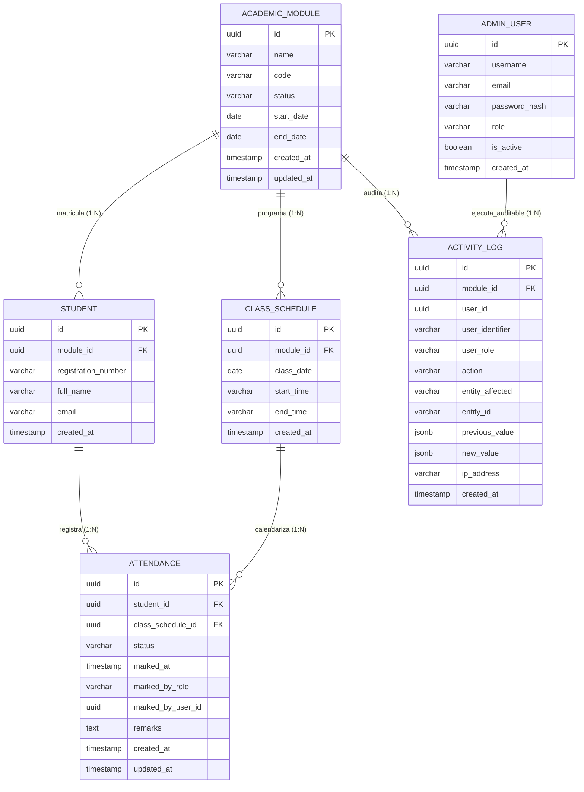

# Diagrama de Clases - Sistema Web de Registro y Control de Asistencia

Este documento presenta el diseño del modelo de dominio y el diagrama de clases para el **Sistema Web de Registro y Control de Asistencia**, estructurado a partir del documento de requerimientos funcionales y reglas de negocio (RF-01 a RF-18, RN-01 a RN-08).

---

## 1. Diagrama de Clases UML (Mermaid)

El siguiente diagrama modela las entidades del dominio, enumeraciones, objetos de transferencia de datos (DTOs) y servicios clave de la arquitectura, manteniendo el principio de desacoplamiento y las directrices arquitectónicas de NestJS y TypeORM.

```mermaid
classDiagram
    %% Enumeraciones del Dominio
    class ModuleStatus {
        <<enumeration>>
        ACTIVE
        INACTIVE
    }

    class AttendanceStatus {
        <<enumeration>>
        PRESENTE
        FALTA
    }

    class UserRole {
        <<enumeration>>
        ADMIN
        STUDENT
    }

    class ActivityAction {
        <<enumeration>>
        LOGIN
        LOGOUT
        MARK_ATTENDANCE
        UPDATE_ATTENDANCE
        IMPORT_STUDENTS
        IMPORT_SCHEDULES
        ACTIVATE_MODULE
        EXPORT_ATTENDANCES
    }

    %% Clase Base de Persistencia
    class AppBaseEntity {
        <<abstract>>
        +Date createdAt
        +Date updatedAt
        +Date deletedAt
    }

    %% Entidades Principales
    class AcademicModule {
        +UUID id
        +string name
        +string code
        +ModuleStatus status
        +Date startDate
        +Date endDate
        +boolean isActive()
        +void activate()
        +void deactivate()
    }

    class Student {
        +UUID id
        +UUID moduleId
        +string registrationNumber
        +string fullName
        +string email
        +boolean belongsToModule(UUID targetModuleId)
    }

    class ClassSchedule {
        +UUID id
        +UUID moduleId
        +Date classDate
        +string startTime
        +string endTime
        +boolean isToday()
        +boolean isPast()
    }

    class Attendance {
        +UUID id
        +UUID studentId
        +UUID classScheduleId
        +AttendanceStatus status
        +Date markedAt
        +UserRole markedByRole
        +UUID markedByUserId
        +string remarks
        +void markPresent(Date timestamp, UUID studentId)
        +void markAbsent()
        +void updateByAdmin(AttendanceStatus newStatus, UUID adminId, string justification)
    }

    class AdminUser {
        +UUID id
        +string username
        +string email
        +string passwordHash
        +UserRole role
        +boolean isActive
        +boolean verifyPassword(string plainPassword)
    }

    class ActivityLog {
        +UUID id
        +UUID moduleId
        +UUID userId
        +string userIdentifier
        +UserRole userRole
        +ActivityAction action
        +string entityAffected
        +string entityId
        +JSON previousValue
        +JSON newValue
        +string ipAddress
        +Date timestamp
    }

    %% DTOs y Objetos de Valor para Importación y Reportes
    class StudentImportDto {
        +string registrationNumber
        +string fullName
        +string email
        +boolean isValid()
    }

    class ScheduleImportDto {
        +string classDate
        +string startTime
        +string endTime
        +boolean isValid()
    }

    class ImportPreviewResult {
        +List~StudentImportDto~ students
        +List~ScheduleImportDto~ schedules
        +List~string~ validationErrors
        +boolean hasErrors
    }

    class AttendanceSummaryDto {
        +UUID studentId
        +string registrationNumber
        +string fullName
        +int totalClasses
        +int presentCount
        +int absentCount
        +float attendancePercentage
    }

    %% Servicios de Aplicación (Lógica de Negocio)
    class ModuleService {
        +AcademicModule getActiveModule()
        +ImportPreviewResult previewImport(file studentsFile, file schedulesFile)
        +AcademicModule activateNewModule(CreateModuleDto dto)
    }

    class StudentService {
        +Student authenticateStudent(string identifier)
        +List~Student~ findStudentsByActiveModule(string searchFilter)
        +Student findById(UUID studentId)
    }

    class AttendanceService {
        +Attendance markAttendance(UUID studentId)
        +List~Attendance~ getStudentHistory(UUID studentId)
        +List~AttendanceMatrixItemDto~ getActiveModuleAttendanceMatrix(Date filterDate, UUID filterStudentId)
        +Attendance modifyAttendanceByAdmin(UUID attendanceId, UpdateAttendanceDto dto, AdminUser admin)
        +byte[] exportAttendanceReport(UUID moduleId)
    }

    class ActivityLogService {
        +void logEvent(CreateLogDto dto)
        +List~ActivityLog~ getLogsByModule(UUID moduleId, Date dateFilter, string studentIdentifierFilter)
    }

    %% Relaciones de Herencia
    AppBaseEntity <|-- AcademicModule
    AppBaseEntity <|-- Student
    AppBaseEntity <|-- ClassSchedule
    AppBaseEntity <|-- Attendance
    AppBaseEntity <|-- AdminUser
    AppBaseEntity <|-- ActivityLog

    %% Relaciones entre Entidades
    AcademicModule "1" *-- "0..*" Student : "contiene"
    AcademicModule "1" *-- "0..*" ClassSchedule : "programa"
    AcademicModule "1" *-- "0..*" ActivityLog : "registra eventos de"
    
    Student "1" *-- "0..*" Attendance : "registra marcas de"
    ClassSchedule "1" *-- "0..*" Attendance : "evalúa asistencia en"

    AdminUser "1" ..> "0..*" Attendance : "modifica/audita"
    AdminUser "1" ..> "0..*" ActivityLog : "genera acciones auditables"

    %% Relaciones con DTOs y Servicios
    ModuleService ..> AcademicModule : "gestiona"
    ModuleService ..> ImportPreviewResult : "construye"
    StudentService ..> Student : "consulta"
    AttendanceService ..> Attendance : "orquesta"
    AttendanceService ..> AttendanceSummaryDto : "calcula"
    AttendanceService ..> ActivityLogService : "emite eventos de auditoría"
    ModuleService ..> ActivityLogService : "emite eventos de auditoría"
```

---

## 2. Descripción Detallada de las Clases y Entidades

### 2.1 Entidad `AcademicModule` (Módulo Académico)
Representa el período académico o curso en ejecución.
* **Propósito:** Cumplir con **RN-01** (*Solo un módulo activo a la vez*), **RF-13** (*Activar un nuevo módulo*), y **RF-15 / RN-08** (*Conservación de datos históricos sin eliminarlos*).
* **Atributos:**
  - `id: UUID`: Identificador único (Primary Key).
  - `name: string`: Nombre descriptivo (ej. "Módulo 2: DevOps e Infraestructura como Código").
  - `code: string`: Código correlativo único (ej. "DCID-V1E1-M2").
  - `status: ModuleStatus`: Estado del módulo (`ACTIVE` o `INACTIVE`).
  - `startDate: Date`: Fecha de inicio del módulo.
  - `endDate: Date`: Fecha estimada de finalización.
  - `createdAt`, `updatedAt`, `deletedAt`: Campos de auditoría temporal (`AppBaseEntity`).
* **Reglas y Métodos:**
  - `activate()`: Cambia el estado a `ACTIVE` y garantiza que cualquier módulo previamente activo pase a `INACTIVE` mediante una transacción ACID.
  - `deactivate()`: Marca el módulo como histórico (`INACTIVE`).
  - `isActive()`: Retorna `true` si el módulo está actualmente en curso.

### 2.2 Entidad `Student` (Estudiante)
Representa al estudiante asignado a un módulo específico.
* **Propósito:** Implementar **RF-01** (*Ingreso de estudiantes mediante correo o registro*), **RF-06** (*Lista de estudiantes del módulo activo*) y **RF-11** (*Importación desde Excel*).
* **Atributos:**
  - `id: UUID`: Identificador único en base de datos.
  - `moduleId: UUID`: Clave foránea referenciando a `AcademicModule`.
  - `registrationNumber: string`: Matrícula o número de registro único dentro del módulo activo (**RN-02**).
  - `fullName: string`: Nombre completo del estudiante.
  - `email: string`: Correo electrónico institucional o personal.
* **Restricción de Negocio (Índice Único Compuesto):**
  - `UNIQUE(moduleId, registrationNumber)`: Permite que un número de registro exista en módulos pasados, pero **nunca duplicado dentro del mismo módulo**.
  - `UNIQUE(moduleId, email)`: Garantiza correspondencia biunívoca en el acceso.

### 2.3 Entidad `ClassSchedule` (Fecha y Horario de Clase)
Representa un día habilitado para clases dentro del módulo.
* **Propósito:** Implementar **RF-12** (*Importar fechas y horarios*) y delimitar los días hábiles de asistencia (**RN-04**).
* **Atributos:**
  - `id: UUID`: Identificador único.
  - `moduleId: UUID`: Clave foránea referenciando a `AcademicModule`.
  - `classDate: Date`: Fecha de la clase (formato `YYYY-MM-DD`). Determina la validez del registro.
  - `startTime: string`: Hora programada de inicio (informativo, ej. `"18:00"`).
  - `endTime: string`: Hora programada de cierre (informativo, ej. `"21:00"`).
* **Restricción de Negocio:**
  - `UNIQUE(moduleId, classDate)`: No pueden existir dos entradas de clase para el mismo día dentro del mismo módulo.
* **Regla de Negocio:**
  - Para esta versión, los horarios `startTime` y `endTime` son informativos; la habilitación de la marcación cubre las 00:00:00 a 23:59:59 de la fecha `classDate` sin cálculo de atrasos ni tolerancias.

### 2.4 Entidad `Attendance` (Asistencia)
Almacena el registro puntual del estado de presencia de un estudiante en una fecha de clase.
* **Propósito:** Implementar **RF-03** (*Registrar asistencia con botón*), **RF-04** (*Identificación de faltas*), **RF-05** (*Historial personal*) y **RF-07** (*Modificar asistencias*).
* **Atributos:**
  - `id: UUID`: Identificador único.
  - `studentId: UUID`: Clave foránea referenciando a `Student`.
  - `classScheduleId: UUID`: Clave foránea referenciando a `ClassSchedule`.
  - `status: AttendanceStatus`: Enum (`PRESENTE`, `FALTA`).
  - `markedAt: Date | null`: Marca de tiempo real en que el estudiante presionó el botón (en UTC con timestamp). Si es `FALTA` generada al cierre del día, puede ser nulo o indicar la fecha de cierre.
  - `markedByRole: UserRole`: Rol que registró o actualizó la marca (`STUDENT` o `ADMIN`).
  - `markedByUserId: UUID | null`: ID del usuario responsable de la última modificación (para soporte de **RN-07**).
  - `remarks: string | null`: Justificación obligatoria cuando el administrador modifica el registro.
* **Restricción de Negocio (Idempotencia y Unicidad):**
  - `UNIQUE(studentId, classScheduleId)`: Satisface **RN-03** (*Una sola marca de asistencia por estudiante y fecha de clase*).

### 2.5 Entidad `AdminUser` (Administrador del Sistema)
Gestiona las credenciales y el acceso administrativo del sistema.
* **Propósito:** Implementar **RF-02** (*Acceso del administrador mediante credenciales propias*).
* **Atributos:**
  - `id: UUID`: Identificador único.
  - `username: string`: Nombre de usuario único (ej. `"admin"`).
  - `email: string`: Correo electrónico institucional.
  - `passwordHash: string`: Hash seguro generado con `bcrypt` (mínimo 10 rondas de salt). Con decorador `{ select: false }` para no exponerlo.
  - `role: UserRole`: Siempre `ADMIN`.
  - `isActive: boolean`: Indicador de cuenta activa.

### 2.6 Entidad `ActivityLog` (Registro de Actividades / Auditoría)
Registra de forma inmutable todas las operaciones sensibles del sistema.
* **Propósito:** Cumplir con **RF-09** (*Registro de actividades*), **RF-10** (*Consulta de actividades*) y **RN-07** (*Toda modificación administrativa de asistencia queda auditada*).
* **Atributos:**
  - `id: UUID`: Identificador único.
  - `moduleId: UUID`: Clave foránea referenciando a `AcademicModule`. Permite filtrar el log por el módulo activo sin mezclar operaciones históricas.
  - `userId: UUID | null`: Identificador del usuario que ejecutó la acción (Admin o Estudiante).
  - `userIdentifier: string`: Correo, matrícula o nombre de usuario en texto para consulta directa rápida.
  - `userRole: UserRole`: Rol del autor (`ADMIN` o `STUDENT`).
  - `action: ActivityAction`: Acción ejecutada (`LOGIN`, `MARK_ATTENDANCE`, `UPDATE_ATTENDANCE`, `IMPORT_STUDENTS`, `ACTIVATE_MODULE`, etc.).
  - `entityAffected: string`: Nombre de la entidad impactada (ej. `"Attendance"`, `"Student"`, `"AcademicModule"`).
  - `entityId: string | null`: ID del registro afectado.
  - `previousValue: JSON | null`: Estado anterior del registro (ej. `{"status": "FALTA"}`).
  - `newValue: JSON | null`: Nuevo estado asignado (ej. `{"status": "PRESENTE", "justification": "Justificante médico presentado"}`).
  - `ipAddress: string | null`: Dirección IP cliente o User-Agent.
  - `timestamp: Date`: Fecha y hora del suceso (`createdAt`).

---

## 3. Matriz de Cumplimiento de Reglas de Negocio en el Modelo

| Regla de Negocio | Descripción en Documento | Mecanismo de Implementación en Clases / Base de Datos |
| :--- | :--- | :--- |
| **RN-01** | Solo un módulo activo a la vez. | Índice condicional único en PostgreSQL: `CREATE UNIQUE INDEX idx_only_one_active_module ON academic_modules (status) WHERE (status = 'ACTIVE')`. Validación en `ModuleService.activateNewModule()`. |
| **RN-02** | Número de registro único entre estudiantes del módulo activo. | Restricción única compuesta en `Student`: `@Unique(['moduleId', 'registrationNumber'])`. Validación previa durante la carga de Excel en `StudentImportDto`. |
| **RN-03** | Una sola marca de asistencia por estudiante y fecha de clase. | Restricción única compuesta en `Attendance`: `@Unique(['studentId', 'classScheduleId'])`. Impide duplicados concurrentes en base de datos. |
| **RN-04** | El estudiante solo puede marcar durante el día de clase programado. | Validación en `AttendanceService.markAttendance()` comparando `currentDate` (servidor) con `ClassSchedule.classDate`. El botón en Frontend se deshabilita si `isToday() == false`. |
| **RN-05** | Al terminar el día, la ausencia de marca equivale a Falta. | Lógica de consulta: Todo cruce entre `Student` y `ClassSchedule` con fecha menor a la actual sin registro en `Attendance` se interpreta o persiste automáticamente como `status: FALTA`. |
| **RN-06** | Solo el administrador puede modificar asistencias fuera de fecha. | Protegido con `RolesGuard(UserRole.ADMIN)` en endpoint `PATCH /attendances/:id`. Endpoint de estudiante solo admite `POST /attendances/check-in` para el día actual. |
| **RN-07** | Toda modificación administrativa de asistencia queda auditada. | Interceptor / Hook en `AttendanceService.modifyAttendanceByAdmin()` que invoca `ActivityLogService.logEvent()` persistiendo `previousValue`, `newValue`, `adminId` y `timestamp`. |
| **RN-08** | El reinicio no borra información histórica de la base de datos. | Transacción de activación que únicamente ejecuta `UPDATE academic_modules SET status = 'INACTIVE' WHERE status = 'ACTIVE'`, conservando intactas las claves foráneas y registros pasados. |

---

## 4. Diagrama Entidad-Relación Lógico (Derivado de las Clases)

