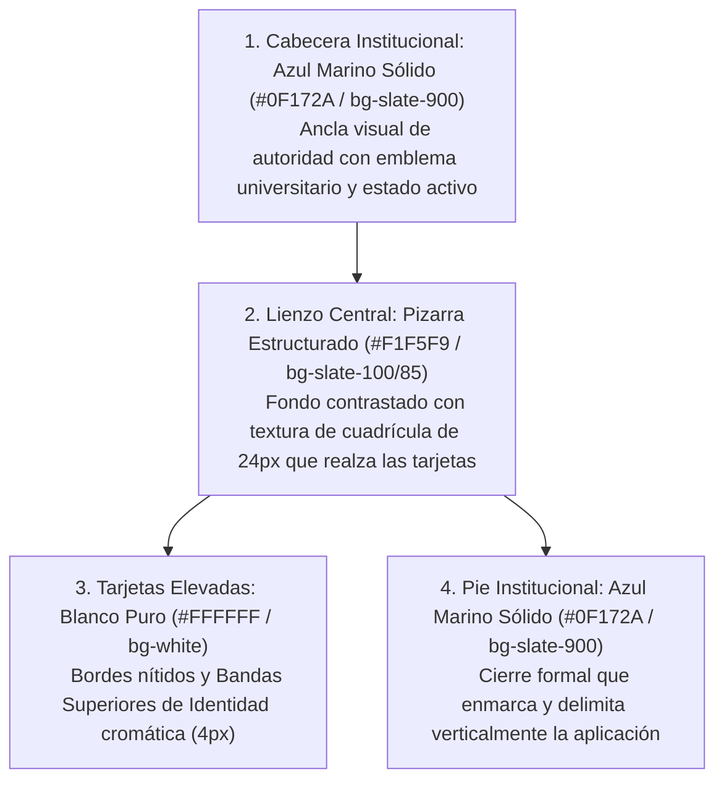
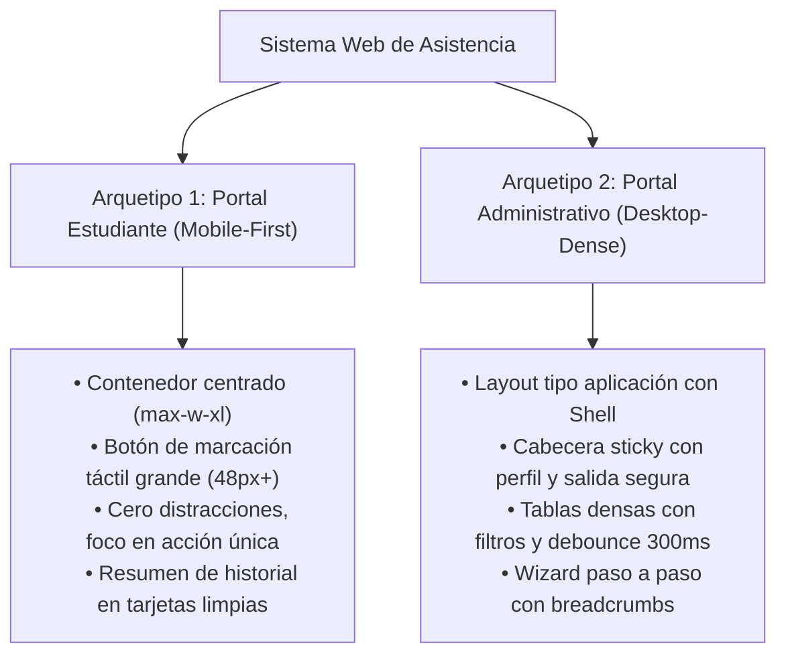

# Dirección Visual General - Sistema Web de Registro y Control de Asistencia

Este documento establece la **Dirección Visual Oficial y Sistema de Diseño** para la refactorización integral de todas las vistas del **Sistema Web de Registro y Control de Asistencia** (Diplomado DevOps • Módulo 2 IaC). Define el tono visual, paleta cromática, escala tipográfica, arquetipos de interfaz, componentes base, micro-interacciones y pautas de accesibilidad para proyectar rigor académico e institucional.

---

## 🏛️ 1. Filosofía de Diseño: Rigor Académico y Contención Visual

### 1.1. Contexto y Propósito del Producto
* **Naturaleza del Sistema:** Plataforma institucional y académica de educación superior (Postgrado / Diplomado Universitario).
* **Premisa Central:** No es una landing promocional ni un producto publicitario; es una **herramienta transaccional y analítica de misión crítica**.
* **Valores del Diseño:**
  1. **Confianza y Solidez:** La interfaz debe comunicar estabilidad, trazabilidad y precisión administrativa.
  2. **Contención Visual (*Restraint*):** Erradicación de degradados saturados estridentes, animaciones de scroll innecesarias, sombras difusas exageradas o radios tipo píldora (`rounded-full`) en contenedores estructurales.
  3. **Eficiencia Transaccional:** Minimizar la fricción cognitiva. Un estudiante debe poder registrar su asistencia en menos de 3 segundos desde su teléfono; un administrador debe poder auditar módulos y nóminas con densidad informativa limpia.

---

## 🎨 2. Paleta Cromática y Tokens Semánticos

La paleta se fundamenta en un **Azul Marino Institucional Profundo** acompañado de una escala neutra de pizarras (*Slate*) de alta legibilidad y un conjunto de **acentos semánticos universales** para el ciclo de vida de la asistencia.

### 2.1. Colores de Identidad y Superficie (Enmarcado Institucional de Alto Contraste)

Para erradicar la monotonía de una "pantalla plana totalmente blanca" y al mismo tiempo evitar el look oscuro de consola técnica, la interfaz adopta una arquitectura de **Enmarcado Institucional (*Navy Framing*) con Lienzo Pizarra Estructurado**:

| Token de Color | Valor Hex | Clase Tailwind | Rol en la Interfaz |
| :--- | :--- | :--- | :--- |
| **Primary Navy (Enmarcado)** | `#0F172A` / `#1E293B` | `bg-slate-900` | Cabecera superior y pie institucional; anclan con autoridad la pantalla y eliminan el vacío blanco. |
| **Canvas Background (Lienzo)** | `#EEF2F6` / `#F1F5F9` | `bg-slate-100/85` | Fondo general de la aplicación con tinte pizarra y trama sutil; genera contraste directo con las tarjetas blancas. |
| **Surface Card (Tarjetas)** | `#FFFFFF` | `bg-white` | Tarjetas de contenido, formularios y tablas. Resaltan limpiamente sobre el lienzo pizarra con relieve óptico. |
| **Banda Acento Estudiantes** | `#10B981` / `#059669` | `border-t-4 border-t-emerald-500` | Franja superior que identifica unívocamente las tarjetas y flujos del alumno. |
| **Banda Acento Administración** | `#4F46E5` / `#1E3A8A` | `border-t-4 border-t-indigo-600` | Franja superior que identifica las tarjetas y flujos de coordinación y docencia. |
| **Text Primary (Titulares)** | `#0F172A` | `text-slate-900` | Títulos y máximos jerárquicos con legibilidad y contraste superior a 12:1. |
| **Text Secondary (Cuerpo)** | `#475569` | `text-slate-600` | Párrafos informativos y metadatos con contraste superior a 4.5:1. |
| **Border Neutral** | `#E2E8F0` | `border-slate-200/90` | Delimitadores de 1px entre filas, tablas y contornos de tarjetas. |

---

### 2.2. Semántica Universal de Estados de Asistencia

Los estados de asistencia no deben prestarse a equívocos y deben mantener coherencia cromática y simbólica en todas las tablas, badges, KPIs y tarjetas:

| Estado | Token Color | Fondo Badge | Borde Badge | Texto Badge | Icono Mandatorio | Significado de Negocio |
| :--- | :--- | :--- | :--- | :--- | :--- | :--- |
| **Presente** | `#059669` (Esmeralda) | `bg-emerald-50 dark:bg-emerald-950/60` | `border-emerald-200 dark:border-emerald-800` | `text-emerald-700 dark:text-emerald-300` | `CheckCircle2` | Marcación confirmada en tiempo real o por administrador. |
| **Falta / Ausente** | `#DC2626` (Carmesí) | `bg-rose-50 dark:bg-rose-950/50` | `border-rose-200 dark:border-rose-800` | `text-rose-700 dark:text-rose-300` | `XCircle` | Sesión pasada concluida sin registro (cómputo automático RN-05). |
| **Justificada** | `#D97706` (Ámbar) | `bg-amber-50 dark:bg-amber-950/60` | `border-amber-200 dark:border-amber-800` | `text-amber-800 dark:text-amber-300` | `AlertTriangle` | Falta dispensada con justificación auditada por administrador. |
| **Pendiente / Futura** | `#64748B` (Pizarra) | `bg-slate-100 dark:bg-slate-800/70` | `border-slate-200 dark:border-slate-700` | `text-slate-600 dark:text-slate-400` | `Clock` | Sesión del cronograma aún no ocurrida o clase en curso sin marcar. |

> [!IMPORTANT]
> **Accesibilidad Cromática (WCAG 2.2):** Todo indicador de asistencia debe combinar el **color semántico + icono SVG explícito + etiqueta textual clara**. Queda prohibido indicar el estado únicamente con un punto de color sin texto explicativo.

---

## 🔤 3. Tipografía y Jerarquía de Contenidos

### 3.1. Familias Tipográficas
* **Fuente Principal de Interfaz:** `Geist Sans` (o `Inter` en fallback).
  * Limpia, moderna, con caracteres diseñados para interfaces gráficas densas y alta legibilidad en pantallas de cualquier tamaño.
* **Fuente Numérica y de Códigos:** `Geist Mono` (o `JetBrains Mono` / `ui-monospace`).
  * **Uso obligatorio (`font-mono tabular-nums`) en:**
    * Números de registro / matrículas de estudiantes (`REG-2026-001`).
    * Códigos de módulo académico (`MOD-2026-02`).
    * Horas de inicio y fin (`19:00 - 22:00`).
    * Fechas tabulares (`14/10/2026`).
    * Métricas y porcentajes (`95.5%`, `18/20`).

### 3.2. Escala de Textos y Jerarquía Visual

| Nivel | Tamaño | Peso | Tracking | Uso en la Aplicación |
| :--- | :--- | :--- | :--- | :--- |
| **Display / H1** | `24px` a `28px` (`text-2xl` a `text-3xl`) | `font-bold` | `tracking-tight` | Título del Dashboard principal y pantalla de asistencia. |
| **H2 Sección** | `18px` a `20px` (`text-lg` a `text-xl`) | `font-semibold` | `tracking-tight` | Título de secciones de configuración, tarjetas de módulo y nómina. |
| **H3 Subtítulo** | `14px` a `15px` (`text-sm` a `text-base`) | `font-medium` | normal | Encabezados de cards de resumen y modales de confirmación. |
| **Body General** | `13px` a `14px` (`text-xs` a `text-sm`) | `font-normal` | normal | Párrafos informativos, descripciones y textos explicativos. |
| **Labels & Metadatos** | `11px` a `12px` (`text-[11px]` a `text-xs`) | `font-semibold` | `tracking-wider uppercase` | Encabezados de columnas en tablas, micro-badges y etiquetas de formulario. |
| **Cifras Tabulares** | `13px` a `14px` | `font-mono font-medium` | `tabular-nums` | Celdas numéricas de fechas, horas y horas de marcación auditada. |

---

## 📐 4. Arquitectura de Layouts: Dos Arquetipos de Experiencia

El sistema atiende a dos perfiles de usuario con necesidades y entornos de uso radicalmente distintos. Por ello, la interfaz se estructura bajo **dos arquetipos visuales diferenciados**:

### 4.1. Arquetipo 1: Portal de Estudiantes (Centrado, Foco Único, Mobile-First)
* **Vistas:** `/login`, `/asistencia`, `/historial`.
* **Contexto de Uso:** El alumno está en el aula, de pie, o conectándose desde un smartphone o tablet con tiempo limitado para marcar su asistencia.
* **Directrices de Layout:**
  * **Ancho Máximo:** Contenedores centrados con límite de lectura ergonómico: `max-w-md` para login y `max-w-2xl` para marcación e historial.
  * **Touch Targets Generosos:** El botón de marcación de asistencia debe tener una altura mínima de `56px` (`h-14`), con área táctil cómoda y tipografía legible (`text-base font-bold`).
  * **Flujo Lineal:** Cabecera superior compacta (`h-14`) que exhibe el nombre del estudiante y registro, con selector entre "Marcación de Hoy" y "Mi Historial".
  * **Feedback Inmediato:** El estado de marcación se evidencia en el primer scroll sin necesidad de navegar.

### 4.2. Arquetipo 2: Portal Administrativo (Estructurado, Denso, Desktop-First)
* **Vistas:** `/admin/dashboard`, `/admin/estudiantes`, `/admin/modulo/importar`, `/admin/modulo/importar/fechas`, `/admin/modulo/preview`.
* **Contexto de Uso:** Personal administrativo, coordinadores y docentes gestionando módulos, nóminas de 50+ alumnos y cronogramas de clases.
* **Directrices de Layout:**
  * **Ancho Máximo:** Contenedor ancho estándar `max-w-7xl` con padding responsivo (`px-4 sm:px-6 lg:px-8`).
  * **Cabecera Sticky con Información de Sesión:** Barra persistente con blur (`backdrop-blur-md bg-white/80 dark:bg-slate-900/80`), breadcrumb de navegación, datos del administrador y botón con modal de confirmación de salida.
  * **Tablas de Datos Densas:** Filas con altura fija uniforme (`py-3 sm:py-3.5`), alternancia de filas o separación limpia con `border-b border-slate-150`, paginación fija en el pie y campos de búsqueda con indicador de carga discreto.
  * **Asistente (Wizard) Guiado:** Pasos numerados claros (1: Estudiantes → 2: Calendario → 3: Vista Previa y Activación), con validación previa que impide avanzar si existen inconsistencias sintácticas.

---

### 5.1. Tarjetas y Superficies (*Surfaces*)
* **Bandas Superiores de Identidad (*Top Accent Bands*):**
  * Para evitar tarjetas genéricas que se pierdan en el lienzo y eliminar la monotonía blanca, las tarjetas principales de flujo incorporan una franja de color superior de 4px (`border-t-4`):
    * **Flujos de Estudiantes / Asistencia:** `border-t-4 border-t-emerald-500` (verde esmeralda universitario).
    * **Flujos de Administración / Docencia:** `border-t-4 border-t-indigo-600` (índigo / azul marino institucional).
* **Bordes, Sombras y Relieve:**
  * Superficies blancas puras (`bg-white`) sobre el lienzo pizarra contrastado (`bg-slate-100/85`).
  * Bordes laterales e inferiores de 1px: `border border-slate-200/90`.
  * Elevación óptica: Sombras contenidas (`shadow-sm hover:shadow-xl hover:shadow-slate-300/40`) con micro-transición suave (150-200ms).
* **Radio de Borde (*Border Radius*):**
  * Tarjetas de portal, accesos y contenedores interactivos: `rounded-2xl` (`16px`) a `rounded-3xl` (`24px`).
  * Tablas de datos y paneles modulares densos: `rounded-xl` (`12px`) a `rounded-2xl` (`16px`).
  * Botones e inputs de formulario: `rounded-lg` (`8px`) a `rounded-xl` (`12px`).
  * Badges y contadores numéricos: `rounded-full` o `rounded-md` (`6px`).

### 5.2. Botones y Elementos Accionables
* **Botón Primario (Acción Principal):**
  * Fondo `bg-indigo-600 hover:bg-indigo-700 active:bg-indigo-800 text-white font-semibold`.
  * Micro-escala al presionar: `active:scale-[0.98] transition-all duration-150`.
* **Botón de Marcación Estudiantil (Acción Crítica):**
  * Fondo `bg-emerald-600 hover:bg-emerald-700 text-white font-bold text-base shadow-sm hover:shadow-md`.
  * Estados de transición fluidos: Normal → Loading (Spinner integrado) → Success (Check verde bloqueado).
* **Botón Secundario / Outline:**
  * Fondo `bg-white hover:bg-slate-50 dark:bg-slate-900 dark:hover:bg-slate-800 border border-slate-300 dark:border-slate-700 text-slate-700 dark:text-slate-200`.
* **Botón Destructivo / Peligro:**
  * Fondo `bg-rose-50 hover:bg-rose-100 text-rose-700 border border-rose-200 dark:bg-rose-950/40 dark:text-rose-300 dark:border-rose-900`.
* **Cursores y Foco:**
  * Siempre declarar `cursor-pointer` explícito en todos los botones y enlaces interactivos.
  * Anillo de foco accesible obligatorio: `focus-visible:outline-none focus-visible:ring-2 focus-visible:ring-indigo-600 focus-visible:ring-offset-2`.

### 5.3. Formularios e Inputs
* **Inputs de Texto / Búsqueda:**
  * Altura estándar: `h-10` (`40px`) en escritorio, `h-11` (`44px`) en móvil.
  * Fondo `bg-white dark:bg-slate-900 border border-slate-300 dark:border-slate-700 text-slate-900 dark:text-slate-100 placeholder:text-slate-400`.
  * Foco: `focus:border-indigo-600 focus:ring-1 focus:ring-indigo-600`.
* **Feedback de Errores en Inputs:**
  * Borde `border-rose-500`, texto auxiliar de error en `text-xs font-medium text-rose-600 dark:text-rose-400` con icono `AlertCircle` de 14px.

### 5.4. Tablas de Datos
* **Cabecera (`<thead>`):**
  * Fondo neutro suave `bg-slate-50 dark:bg-slate-850/60 border-b border-slate-200 dark:border-slate-800`.
  * Texto en mayúsculas pequeñas `text-[11px] font-bold text-slate-500 dark:text-slate-400 tracking-wider`.
* **Celdas (`<td>`):**
  * Altura cómoda con padding vertical uniforme (`py-3 sm:py-3.5 px-4`).
  * Textos alineados a la izquierda, importes/cifras/fechas tabulares alineadas a la derecha o con alineación óptica rigurosa.
  * Efecto hover sutil: `hover:bg-slate-50/70 dark:hover:bg-slate-800/40 transition-colors`.

---

## ⚡ 6. Micro-interacciones y Feedback Sensorial

Guiados por los principios de **Emil Kowalski** y **Apple Design**:

1. **Latencia Cero en el Click:**
   * La interfaz debe responder inmediatamente al click o tap. Si una acción toma más de 100ms (ej. llamada a la API), el botón debe entrar en estado de carga visible (`disabled + animate-spin Loader2`).
2. **Duración y Curvas de Transición:**
   * Duración máxima estándar: `150ms` a `200ms`.
   * Curva de animación: `cubic-bezier(0.16, 1, 0.3, 1)` (curva natural desacelerada tipo iOS) o `ease-out`.
   * Prohibido el uso de transiciones lentas (>350ms) que demoren el trabajo del usuario.
3. **Modales y Diálogos de Confirmación:**
   * Transición de entrada: Opacidad de fondo `fade-in duration-200` y escala de contenido `scale-95 to scale-100 duration-200 ease-out`.
   * Cierre con tecla `Escape` y click en el backdrop oscuro.
4. **Respeto a Preferencias del Usuario (`prefers-reduced-motion`):**
   * Cualquier animación de pulso, spin o fade debe desactivarse o simplificarse para usuarios con sensibilidad al movimiento (`motion-reduce:animate-none`).

---

## 📋 7. Lista de Verificación (*Checklist*) de Refactorización por Vista

Antes de dar por aprobada la refactorización visual de cualquiera de las vistas, se debe validar:

- [ ] **Enmarcado Institucional y Contraste de Fondo:** ¿La vista usa la cabecera azul marino (`bg-slate-900`) y el lienzo pizarra estructurado (`bg-slate-100/85`) para evitar el efecto de página blanqueada?
- [ ] **Identidad de Rol con Bandas Superiores:** ¿Las tarjetas principales de acceso o resumen incorporan su banda de color superior (`border-t-4`) según el perfil (Esmeralda para Estudiantes, Índigo para Administración)?
- [ ] **Alineación con el Arquetipo:** ¿Cumple con el arquetipo asignado (Estudiante Mobile-First vs. Admin Desktop-Dense)?
- [ ] **Contención de Gradientes:** ¿Se eliminaron los fondos de marketing saturados en favor del enmarcado institucional limpio y sobrio?
- [ ] **Semántica de Asistencia:** ¿Los estados de asistencia usan la paleta unificada (Esmeralda = Presente, Carmesí = Falta, Ámbar = Justificada, Pizarra = Pendiente)?
- [ ] **Legibilidad Numérica:** ¿Las fechas, horas, códigos de módulo y matrículas usan `font-mono tabular-nums`?
- [ ] **Accesibilidad (Contraste 4.5:1):** ¿Los textos y badges cumplen con la norma WCAG 2.2 AA sobre sus respectivos fondos?
- [ ] **Touch Targets Móviles:** ¿Los botones táctiles en vistas de estudiante tienen al menos 48px a 56px de altura?
- [ ] **Feedback de Carga:** ¿Todas las acciones asíncronas muestran loaders claros y deshabilitan el re-envío accidental?
- [ ] **Búsqueda con Debounce:** ¿Los inputs de filtrado masivo aplican debounce de 300ms con indicador visual de búsqueda activa?
- [ ] **Confirmación de Acciones Críticas:** ¿El cierre de sesión y la activación de módulo cuentan con modales claros de doble confirmación?

---

## 🔗 Referencias Cruzadas

* **Catálogo de Vistas:** [`docs/vistas-frontend.md`](vistas-frontend.md)
* **Regla de Protocolo de Diseño:** [`.agents/rules/frontend-design-direction-and-skills.md`](file:///.agents/rules/frontend-design-direction-and-skills.md)
* **Criterios de Aceptación HU:** [`docs/historias-de-usuario.md`](historias-de-usuario.md)
