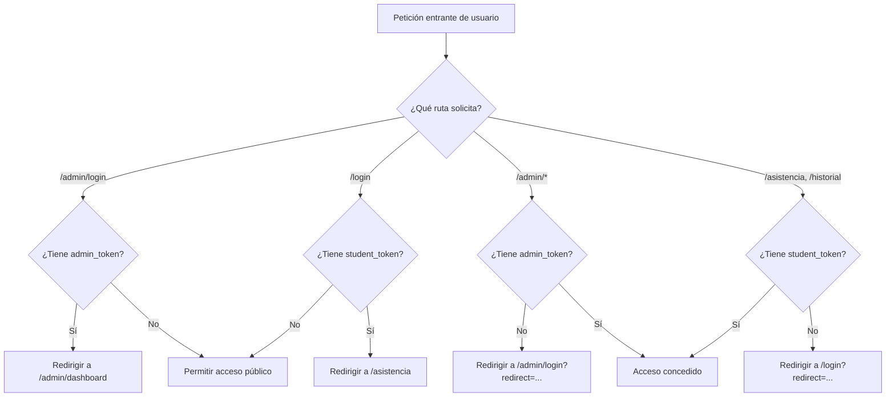
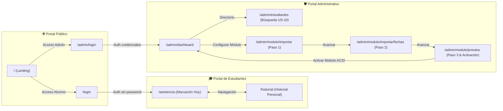

# Catálogo de Vistas del Frontend - Sistema de Control de Asistencia

Este documento presenta el inventario exhaustivo, técnico y funcional de todas las vistas, páginas y flujos de usuario implementados en el módulo frontend del **Sistema Web de Registro y Control de Asistencia** (Diplomado DevOps • Módulo 2 IaC).

---

## 🛠️ Stack Tecnológico y Arquitectura

* **Framework:** Next.js 16 (App Router con React Server & Client Components)
* **Librería UI:** React 19 + TypeScript
* **Estilos:** Tailwind CSS v4 con modo oscuro y diseño responsive adaptativo
* **Iconografía:** Lucide React
* **Gestión de Sesión & Seguridad:** Next.js Middleware (`frontend/src/middleware.ts`) con tokens en cookies (`admin_token` y `student_token`), control de acceso basado en roles (RBAC) y `sessionStorage` para flujos por etapas (Wizard).

---

## 🗺️ Matriz Resumen de Vistas

| # | Vista / Pantalla | Ruta URL | Archivo Fuente | Acceso / Protección | HU / RF Asociados |
| :---: | :--- | :--- | :--- | :--- | :--- |
| **01** | **Portal Principal (Landing)** | `/` | `src/app/page.tsx` | Público | General / Bienvenida |
| **02** | **Login de Estudiantes** | `/login` | `src/app/(estudiante)/login/page.tsx` | Público (Redirige si ya hay sesión) | US-02, RF-01, RN-02 |
| **03** | **Marcación de Asistencia** | `/asistencia` | `src/app/(estudiante)/asistencia/page.tsx` | Protegido (`student_token`) | US-02, US-03, RF-02, RF-03, RN-03, RN-04 |
| **04** | **Historial de Asistencias** | `/historial` | `src/app/(estudiante)/historial/page.tsx` | Protegido (`student_token`) | US-03, RF-04, RF-05, RN-05 |
| **05** | **Login de Administrador** | `/admin/login` | `src/app/admin/login/page.tsx` | Público (Redirige si ya hay sesión) | US-01, RF-07 |
| **06** | **Dashboard de Administración** | `/admin/dashboard` | `src/app/admin/dashboard/page.tsx` | Protegido (`admin_token`, Rol: `ADMIN`) | US-01, US-03, US-07, RN-01, RN-08 |
| **07** | **Directorio de Estudiantes** | `/admin/estudiantes` | `src/app/admin/estudiantes/page.tsx` | Protegido (`admin_token`, Rol: `ADMIN`) | US-10, RF-06, RN-01 |
| **08** | **Asistente Módulo - Paso 1 (Estudiantes)** | `/admin/modulo/importar` | `src/app/admin/modulo/importar/page.tsx` | Protegido (`admin_token`, Rol: `ADMIN`) | US-04, RF-11, RN-02 |
| **09** | **Asistente Módulo - Paso 2 (Calendario)** | `/admin/modulo/importar/fechas` | `src/app/admin/modulo/importar/fechas/page.tsx` | Protegido (`admin_token`, Rol: `ADMIN`) | US-05, RF-12, RN-04 |
| **10** | **Asistente Módulo - Paso 3 (Vista Previa & Activación)** | `/admin/modulo/preview` | `src/app/admin/modulo/preview/page.tsx` | Protegido (`admin_token`, Rol: `ADMIN`) | US-06, US-07, RF-16, RF-18, RN-01, RN-08 |

---

## 🔒 Mecanismo Centralizado de Middleware y Guards

La seguridad perimetral del frontend está centralizada en [`frontend/src/middleware.ts`](file:///frontend/src/middleware.ts):

---

## 📱 Especificación Detallada de las Vistas

### 1. Portal Principal (Landing Page)
* **Ruta:** `/`
* **Archivo:** [`frontend/src/app/page.tsx`](file:///frontend/src/app/page.tsx)
* **Tipo:** Server Component Público.
* **Descripción:** Pantalla de bienvenida institucional del Diplomado DevOps (Módulo 2 IaC). Permite al visitante seleccionar el punto de entrada a la plataforma según su rol:
  * **Acceso Administrativo:** Redirige a `/admin/login` para gestionar la plataforma, nóminas y calendarios.
  * **Acceso Estudiantes:** Redirige a `/login` para registro de asistencias mediante número de registro o correo.
* **Componentes clave:** Cards de navegación con micro-interacciones hover, badges de contexto académico y enlaces tipados de Next.js.

---

### 2. Login de Estudiantes (Acceso sin contraseña)
* **Ruta:** `/login`
* **Archivo:** [`frontend/src/app/(estudiante)/login/page.tsx`](file:///frontend/src/app/%28estudiante%29/login/page.tsx)
* **Componente interactivo:** [`StudentLoginForm`](file:///frontend/src/features/auth/components/StudentLoginForm.tsx)
* **Tipo:** Client Component Público.
* **Reglas de Acceso:**
  * Si el usuario ya posee una cookie `student_token` válida, el middleware lo redirige automáticamente a `/asistencia`.
* **Reglas de Negocio & HU:**
  * **US-02 / RF-01:** Acceso sin contraseña mediante número de matrícula/registro o correo electrónico institucional.
  * **RN-02:** Verificación contra la nómina oficial del módulo activo.
* **Funcionalidad:**
  * Entrada única de texto para ingresar matrícula (ej: `REG-2026-001`) o email (ej: `alumno@correo.com`).
  * Validación reactiva de formulario.
  * Manejo de estados de carga (`isLoading`), alertas de error de credenciales inexistentes en el módulo activo y persistencia del token de sesión en cookies y `localStorage`.

---

### 3. Marcación de Asistencia en Tiempo Real
* **Ruta:** `/asistencia`
* **Archivo:** [`frontend/src/app/(estudiante)/asistencia/page.tsx`](file:///frontend/src/app/%28estudiante%29/asistencia/page.tsx)
* **Componente principal:** [`TodayClassCard`](file:///frontend/src/features/attendances/components/TodayClassCard.tsx)
* **Hooks:** [`useStudentAuth`](file:///frontend/src/features/auth/hooks/useStudentAuth.ts), [`useAttendanceCheckIn`](file:///frontend/src/features/attendances/hooks/useAttendanceCheckIn.ts)
* **Tipo:** Client Component Protegido (`student_token`).
* **Reglas de Negocio & HU:**
  * **US-02 / RF-02 / RF-03:** Registro de asistencia del estudiante en tiempo real.
  * **RN-01:** Debe existir un módulo académico en estado `ACTIVO`.
  * **RN-03:** Única marcación permitida por estudiante por fecha de clase.
  * **RN-04:** La marcación sólo está permitida durante el día fijado en el cronograma.
* **Funcionalidad:**
  * **Barra Superior del Estudiante:** Identificador con nombre completo, número de matrícula, enlace directo a "Mi Historial" y botón de cierre de sesión seguro.
  * **Tarjeta Informativa de Clase de Hoy:**
    * **Si hoy hay clase programada y no ha marcado:** Muestra horario programado y botón prominente interactivo para registrar la asistencia.
    * **Si ya registró asistencia:** Muestra estado "Presente" con hora exacta auditada y bloquea re-marcaciones (RN-03).
    * **Si hoy no hay clase programada:** Muestra aviso claro "Hoy no hay clase programada", indica la próxima clase programada y deshabilita el botón de marcación (RN-04).

---

### 4. Historial Personal de Asistencias
* **Ruta:** `/historial`
* **Archivo:** [`frontend/src/app/(estudiante)/historial/page.tsx`](file:///frontend/src/app/%28estudiante%29/historial/page.tsx)
* **Componentes principales:**
  * [`AttendanceSummaryCards`](file:///frontend/src/features/attendances/components/AttendanceSummaryCards.tsx)
  * [`AttendanceHistoryTable`](file:///frontend/src/features/attendances/components/AttendanceHistoryTable.tsx)
* **Hooks:** [`useStudentAuth`](file:///frontend/src/features/auth/hooks/useStudentAuth.ts), [`useAttendanceHistory`](file:///frontend/src/features/attendances/hooks/useAttendanceHistory.ts)
* **Tipo:** Client Component Protegido (`student_token`).
* **Reglas de Negocio & HU:**
  * **US-03 / RF-04 / RF-05:** Faltas automáticas computadas y cálculo de balance personal.
  * **RN-05:** Cualquier clase pasada sin registro computa como Falta.
* **Funcionalidad:**
  * **Tarjetas Resumen (KPIs):** Clases Totales, Clases Asistidas, Faltas Acumuladas y Porcentaje Global de Asistencia con colores condicionales según el desempeño.
  * **Tabla Cronológica de Sesiones:** Muestra fecha de la clase, horario, estado de asistencia (Presente, Falta, Justificada, Pendiente) y hora exacta de registro.
  * **Acción de Refresco:** Botón para reconsultar los datos en tiempo real sin recargar la página.

---

### 5. Login de Administrador
* **Ruta:** `/admin/login`
* **Archivo:** [`frontend/src/app/admin/login/page.tsx`](file:///frontend/src/app/admin/login/page.tsx)
* **Componente interactivo:** [`AdminLoginForm`](file:///frontend/src/features/auth/components/AdminLoginForm.tsx)
* **Tipo:** Client Component Público.
* **Reglas de Acceso:**
  * Si el usuario ya cuenta con un `admin_token`, el middleware lo redirige a `/admin/dashboard`.
* **Reglas de Negocio & HU:**
  * **US-01 / RF-07:** Autenticación administrativa con usuario/correo y contraseña encriptada mediante BCrypt.
* **Funcionalidad:**
  * Formulario con soporte para credenciales administrativas.
  * Almacenamiento seguro del token JWT en cookies y `localStorage`.
  * Parámetro `redirect` para retornar a la página protegida intentada originalmente.

---

### 6. Dashboard de Administración (Panel de Control Principal)
* **Ruta:** `/admin/dashboard`
* **Archivo:** [`frontend/src/app/admin/dashboard/page.tsx`](file:///frontend/src/app/admin/dashboard/page.tsx)
* **Componentes principales:**
  * [`LogoutConfirmButton`](file:///frontend/src/features/auth/components/LogoutConfirmButton.tsx)
  * Servicios: [`ModuleImportService`](file:///frontend/src/features/modules/services/module-import.service.ts), [`authService`](file:///frontend/src/features/auth/services/auth.service.ts)
* **Tipo:** Client Component Protegido (`admin_token`, Rol: `ADMIN`).
* **Reglas de Negocio & HU:**
  * **US-01 / US-03 / US-07:** Control de sesión administrativa, observabilidad del módulo activo y activación.
  * **RN-01 / RN-08:** Exhibición del único módulo en curso y garantía de trazabilidad histórica.
* **Funcionalidad:**
  * **Cabecera Administrativa:** Identidad del usuario logueado, badge de rol `ADMIN` y botón de salida segura.
  * **Tarjeta de Módulo Activo:** Detalle del módulo actual (`code`, `name`), total de estudiantes matriculados, total de clases y período de vigencia.
  * **Lanzador del Asistente:** Botón destacado para configurar un nuevo módulo académico mediante el asistente de 3 pasos.
  * **Accesos Rápidos a Pasos del Asistente:** Enlaces independientes a Paso 1 (Estudiantes), Paso 2 (Calendario) y Paso 3 (Vista Previa).
  * **Grid de Historias de Usuario:** Monitor de estado de las HUs implementadas (US-01, US-04, US-05, US-06, US-07, US-10, US-03).
  * **Panel de Información Técnica:** Detalle de rama git, backend endpoint y sesión.

---

### 7. Directorio de Estudiantes del Módulo Activo
* **Ruta:** `/admin/estudiantes`
* **Archivo:** [`frontend/src/app/admin/estudiantes/page.tsx`](file:///frontend/src/app/admin/estudiantes/page.tsx)
* **Componentes principales:**
  * [`StudentSearchBar`](file:///frontend/src/features/students/components/StudentSearchBar.tsx)
  * [`ActiveStudentsTable`](file:///frontend/src/features/students/components/ActiveStudentsTable.tsx)
  * [`LogoutConfirmButton`](file:///frontend/src/features/auth/components/LogoutConfirmButton.tsx)
* **Tipo:** Client Component Protegido (`admin_token`, Rol: `ADMIN`).
* **Reglas de Negocio & HU:**
  * **US-10 / RF-06:** Consulta y búsqueda reactiva de la nómina de estudiantes matriculados en el módulo activo.
* **Funcionalidad:**
  * **Barra de Búsqueda Reactiva con Debounce (300ms):** Búsqueda sin recarga por número de matrícula, nombre completo o correo.
  * **Tabla Paginada:** Navegación por páginas (20 registros por página), estado del estudiante, avatar y fecha de registro.
  * **Contador de Métricas:** Contador de total de estudiantes matriculados devuelto por la API.
  * **Enlace Rápido:** Botón para importar más estudiantes o lanzar un nuevo ciclo.

---

### 8. Asistente de Módulo - Paso 1: Importar Nómina de Estudiantes
* **Ruta:** `/admin/modulo/importar`
* **Archivo:** [`frontend/src/app/admin/modulo/importar/page.tsx`](file:///frontend/src/app/admin/modulo/importar/page.tsx)
* **Componentes principales:**
  * [`FileDropzone`](file:///frontend/src/features/modules/components/FileDropzone.tsx)
  * [`StudentErrorsTable`](file:///frontend/src/features/modules/components/StudentErrorsTable.tsx)
  * [`StudentsTablePreview`](file:///frontend/src/features/modules/components/StudentsTablePreview.tsx)
* **Tipo:** Client Component Protegido (`admin_token`, Rol: `ADMIN`).
* **Reglas de Negocio & HU:**
  * **US-04 / RF-11 / RN-02:** Carga masiva y validación atómica del Excel de estudiantes.
* **Funcionalidad:**
  * **Indicador de Progreso:** Paso 1 de 3.
  * **Guía de Formato:** Especifica las 3 columnas obligatorias: `Número de registro`, `Nombre completo`, `Correo electrónico`.
  * **Carga de Archivo Drag & Drop:** Validación de extensión `.xlsx` / `.xls` y animación de procesamiento.
  * **Manejo de Errores Fila por Fila:** Si el archivo contiene registros duplicados, celdas vacías o correos mal formateados, la tabla `StudentErrorsTable` muestra la fila exacta y el motivo del rechazo.
  * **Vista Previa de Éxito:** Muestra la lista de estudiantes validados y los almacena en `sessionStorage` (`pending_students_import`) para el siguiente paso.

---

### 9. Asistente de Módulo - Paso 2: Importar Calendario de Clases
* **Ruta:** `/admin/modulo/importar/fechas`
* **Archivo:** [`frontend/src/app/admin/modulo/importar/fechas/page.tsx`](file:///frontend/src/app/admin/modulo/importar/fechas/page.tsx)
* **Componentes principales:**
  * [`FileDropzone`](file:///frontend/src/features/modules/components/FileDropzone.tsx)
  * [`ScheduleErrorsTable`](file:///frontend/src/features/modules/components/ScheduleErrorsTable.tsx)
  * [`SchedulesTablePreview`](file:///frontend/src/features/modules/components/SchedulesTablePreview.tsx)
* **Tipo:** Client Component Protegido (`admin_token`, Rol: `ADMIN`).
* **Reglas de Negocio & HU:**
  * **US-05 / RF-12 / RN-04:** Carga masiva y validación del cronograma de fechas y horarios de clase.
* **Funcionalidad:**
  * **Indicador de Progreso:** Paso 2 de 3.
  * **Guía de Formato:** Columnas requeridas: `Fecha` (DD/MM/YYYY), `Hora inicio` (HH:mm) y `Hora fin` (HH:mm).
  * **Zona de Carga:** Detección de fechas pasadas, formatos inconsistentes o rangos inválidos.
  * **Tabla de Errores Fila por Fila:** Desglose pormenorizado en caso de inconsistencias.
  * **Vista Previa de Calendario Ordenado:** Listado ordenado cronológicamente con numeración de sesión.
  * **Persistencia:** Almacena en `sessionStorage` (`pending_schedules_import`) y permite volver al Paso 1 o avanzar al Paso 3.

---

### 10. Asistente de Módulo - Paso 3: Vista Previa Consolidada y Activación
* **Ruta:** `/admin/modulo/preview`
* **Archivo:** [`frontend/src/app/admin/modulo/preview/page.tsx`](file:///frontend/src/app/admin/modulo/preview/page.tsx)
* **Componentes principales:**
  * [`ModuleMetadataForm`](file:///frontend/src/features/modules/components/ModuleMetadataForm.tsx)
  * [`ModulePreviewSummaryCards`](file:///frontend/src/features/modules/components/ModulePreviewSummaryCards.tsx)
  * [`ModulePreviewTabs`](file:///frontend/src/features/modules/components/ModulePreviewTabs.tsx)
  * [`ActivationModalConfirmation`](file:///frontend/src/features/modules/components/ActivationModalConfirmation.tsx)
* **Hook:** [`useModuleImportWizard`](file:///frontend/src/features/modules/hooks/useModuleImportWizard.ts)
* **Tipo:** Client Component Protegido (`admin_token`, Rol: `ADMIN`).
* **Reglas de Negocio & HU:**
  * **US-06 / US-07 / RF-16 / RF-18:** Consolidación de datos, vista previa integral y activación transaccional ACID.
  * **RN-01:** Garantía de un único módulo activo.
  * **RN-08:** Preservación histórica de datos previos (el módulo previo pasa a estado `ARCHIVED`).
* **Funcionalidad:**
  * **Formulario de Metadatos:** Inserción de nombre del módulo y código oficial único (ej: `MOD-2026-02`).
  * **Tarjetas KPI Consolidadas:** Total de alumnos a matricular, total de clases programadas, rango de fechas estimadas y estado de validación global.
  * **Pestañas de Inspección:** Pestaña "Estudiantes" y pestaña "Calendario de Clases" para auditar los datos antes de la persistencia.
  * **Modal de Confirmación Transaccional:** Diálogo modal que alerta sobre el archivado del módulo anterior y solicita confirmación explícita.
  * **Resultado de Activación:** Alerta de confirmación con detalles del módulo persistido y botón de retorno al Dashboard.

---

## 🧩 Modales y Componentes Reutilizables de Interfaz

| Componente | Archivo | Rol / Uso |
| :--- | :--- | :--- |
| **`LogoutConfirmButton`** | `src/features/auth/components/LogoutConfirmButton.tsx` | Botón y modal emergente de confirmación para revocar tokens y cerrar sesión de forma segura sin accidentes. |
| **`ActivationModalConfirmation`** | `src/features/modules/components/ActivationModalConfirmation.tsx` | Modal emergente con advertencia sobre la transacción ACID de activación y preservación de histórico. |
| **`FileDropzone`** | `src/features/modules/components/FileDropzone.tsx` | Contenedor interactivo de carga de archivos Excel con validación de tipo, drag & drop y estados de carga. |
| **`StudentSearchBar`** | `src/features/students/components/StudentSearchBar.tsx` | Entrada de búsqueda con temporizador `debounce` de 300ms integrado para optimizar las peticiones a la API. |
| **`ActiveStudentsTable`** | `src/features/students/components/ActiveStudentsTable.tsx` | Tabla completa con paginación, avatar, datos de contacto y estado para la nómina de estudiantes. |
| **`TodayClassCard`** | `src/features/attendances/components/TodayClassCard.tsx` | Tarjeta inteligente con detección de horarios, bloqueo por fecha y registro de asistencia. |
| **`AttendanceSummaryCards`** | `src/features/attendances/components/AttendanceSummaryCards.tsx` | Tarjetas de métricas estadísticas de asistencia con porcentajes y barras de color. |
| **`AttendanceHistoryTable`** | `src/features/attendances/components/AttendanceHistoryTable.tsx` | Tabla histórica de asistencias con estados visuales (Presente, Falta, Justificada). |

---

## 🔄 Flujo de Navegación del Usuario

